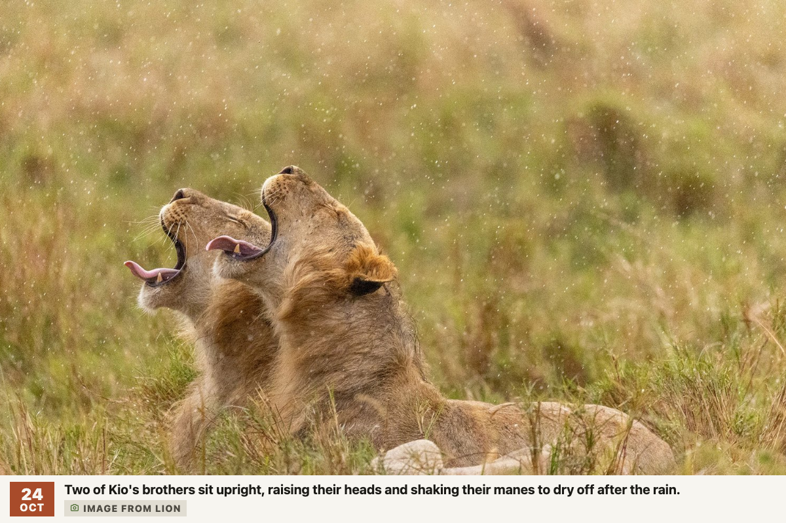

# Picture, National Geographic Photo of the Day

A [Tesserae](https://github.com/dmellok/tesserae) widget that shows National
Geographic's Photo of the Day full bleed on an e-ink dashboard.



| Size | What shows |
|---|---|
| xs, sm | The photo, with the date as a solid accent block in the top-left corner |
| md, lg | The photo above a slim caption band: the date block, the caption, and an "Image from &lt;show&gt;" chip |

The *Show caption band* cell option turns the band off on medium and large
cells. No API key is needed.

## Install

In Tesserae, open **Settings → Widgets → Browse** and install
*Picture, National Geographic Photo of the Day*.

## How it works

- **Feed.** The newest item in National Geographic TV Canada's Photo of the
  Day RSS feed (`feeds.feedburner.com/natgeotv/ca/featured/POD`) gives the
  date, the article link, a thumbnail and the caption. The caption's closing
  "Image from &lt;show&gt;." becomes the chip.
- **Full-size photo.** The feed only carries a 300×169 thumbnail, so the full
  frame is read off the photo's article page on `www.natgeotv.com`. If that
  page can't be read, the thumbnail is shown instead.
- **Local copy.** The full frame is downloaded once, downscaled to 1600px on
  its long side, and served from the widget's own
  `/plugins/picture_natgeo/photos/` route. The renderer loads a few hundred
  kB over loopback instead of a multi-megabyte remote image, and an offline
  host keeps showing the last photo. The newest seven photos are kept.
- **Caching.** The feed answer is cached for 10 minutes in the widget's data
  folder.

### Network and files

`plugin.json` declares, and Tesserae enforces, these hosts:

- `feeds.feedburner.com` (the RSS feed)
- `www.natgeotv.com` (the article page)
- `assets-natgeotv.fnghub.com` and `assets-natgeotv.techops.disn.io` (the
  image, which redirects from the first host to the second)

The widget reads no settings and writes only inside its own data folder.

## Development

The widget follows the Tesserae
[widget contract](https://github.com/dmellok/tesserae/blob/main/docs/widgets.md).
Its tests run inside a Tesserae checkout. Copy or symlink this repo to
`plugins/picture_natgeo/` there, then run:

```sh
uv run pytest plugins/picture_natgeo/ -q
```

## Credits and licence

Photos and captions are © National Geographic and are shown as the feed
publishes them. The widget code is licensed under the
[GNU Affero General Public License v3.0](LICENSE).
